## 1. 소개

- 모드와 함께 사용 가능한 Comfy custom node입니다. 

- 이 튜토리얼은 Comfy에서 Custom Node를 설치하는 정도의 기본적인 지식이 있는 사용자를 대상으로 합니다.

## 2. 적용 방법

1. 이 폴더의 `rim_ai_portrait/`를 `ComfyUI/custom_nodes/rim_ai_portrait/`에 복사하고 ComfyUI를 재시작하세요.

2. RimWorld 모드에서는 **Local (OpenAI compatible)** provider를 선택하고 URL을 `http://127.0.0.1:8188/v1`로 설정합니다. 포트가 다르면 바꿔 주세요. 모델 이름은 `workflows/` 아래 API 형식 JSON 파일의 이름(확장자 제외)입니다.

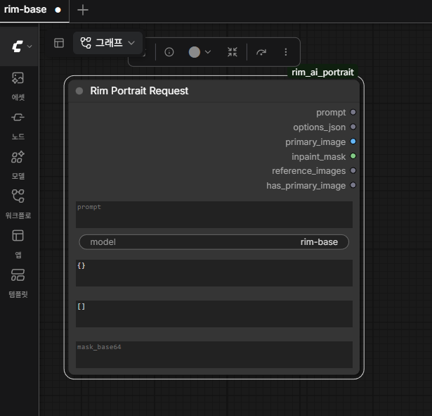

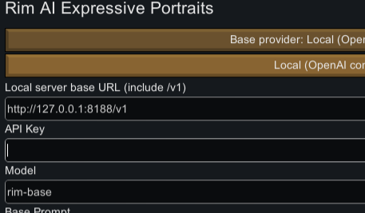

3. 노드를 연결해서 자기 자신만의 셋업을 구성합니다. 실제 초상화 생성에는 ComfyUI에서 **Rim Portrait Request** 노드의 프롬프트·원본 이미지·마스크를 원하는 생성 그래프에 연결하고 최종 `IMAGE`를 **Rim Portrait Response**에 연결하세요. **

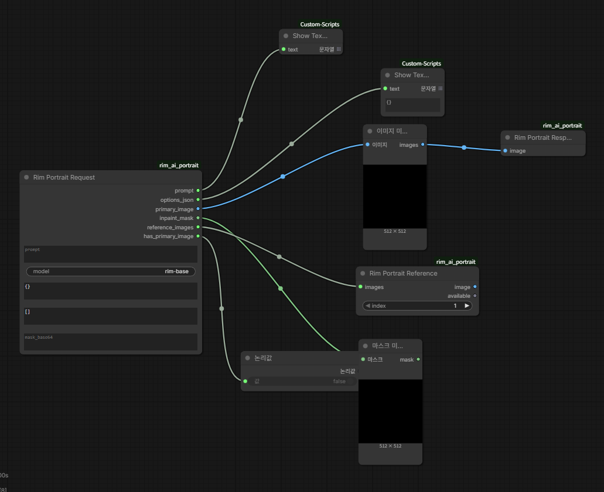

4. Request의 Preview 버튼을 누르면 마지막에 온 요청이 어떤 형태인지 파악할 수 있습니다. 워크플로우를 구성하는데 도움을 줄거에요.

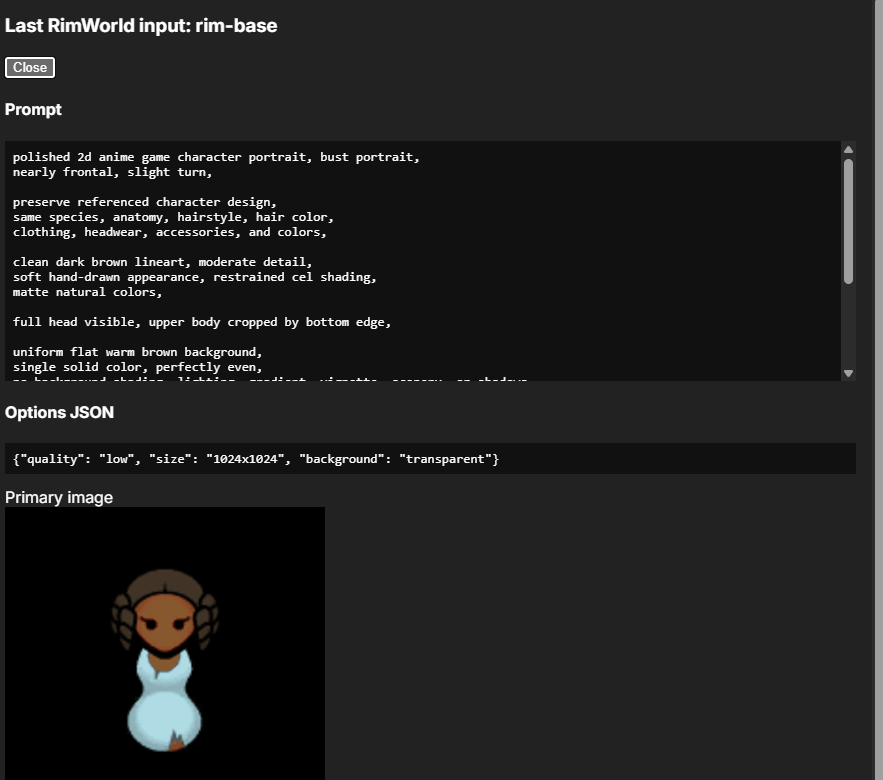

### 3. Custom Node 소개

- Rim Portrait Request: 입력 노드입니다. prompt와 이미지 등 여러 요소를 받을 수 있습니다.
  
  - prompt: 프롬프트입니다. 프롬프트에는 여러 정보들도 포함되어있습니다.
  
  - options_json: 모드 옵션에서 수정 가능한 값입니다. 일반적으로는 사용할 일이 없습니다.
  
  - inpaint_mask: 이미지 수정, 표정 수정 등을 할 때 선택한 영역에 대해 넘어온 마스크입니다.
  
  - reference images: 레퍼런스 이미지입니다. 
  
  - has_primary_image: 주 입력 이미지가 있는지에 대한 검사이비다.
  
  - positive_tag/negative_tag: Tag Extractor를 통해 추출한 값입니다. local model을 돌릴 경우 자연어 프롬프트 처리에 애먹을 확률이 있는데, 언어 모델을 붙이면 상당히 유리할 겁니다.

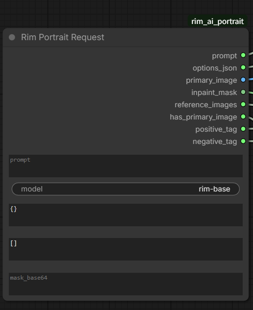

- Rim Portrait Response: 출력 노드입니다. 정상적인 구성에서는 반드시 한 개가 필요합니다.

- Rim Portrait Reference: 레퍼런스 이미지 참조용입니다.

## 4. Custom Workflow 예시: Base

### 4-1. 소개

- 같은 폴더의 rim-base.json은 예시 workflow 입니다.

- 태그를 쉽게 다루기 위해서 [String Function](https://github.com/pythongosssss/ComfyUI-Custom-Scripts) Custom Node를 설치해서 사용하였습니다.

- 캐릭터 스프라이트 특징 추출을 위해서 [IP Adapter](https://github.com/cubiq/ComfyUI_IPAdapter_plus) 를 설치해서 사용하였습니다.

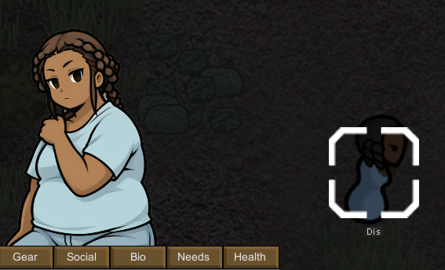

#### 4-2. workflow

#### 4-2-1. 모델 로딩

- 인게임의 Tag-Extractor로 태그를 자동으로 받아오고 있습니다. 예산 절감을 위해 가장 저렴한 gemini-2.5-flash-lite를 사용 중입니다. Tag Extractor 없이 시도해보았으나, 만족할만한 결과를 뽑는 것이 지독하게 어려웠습니다.

- 예시를 위해서 illustrious-XL-v2.0을 사용하고, 원하는 느낌을 학습한 LoRA를 사용하였습니다. LoRA는 혹시나 저작권 이슈가 있을까 공유하지 않습니다.

- IPAdapter를 이용해서 이미지 특징을 추출합니다.

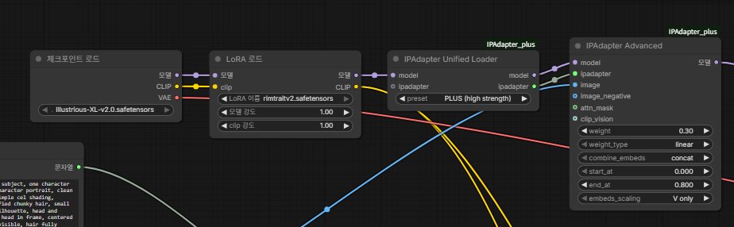

#### 4-2-2. 태그 생성

- 태그를 미리 Comfy의 문자열을 통해 넣어두고, 이를 String Function의 append 기능을 통해서 인게임에서 추출된 Tag와 함께 합치고 있습니다.

- 프롬프트는 Tag Extractor가 알아서 태그를 추출해주니 그냥 버리고 있습니다.

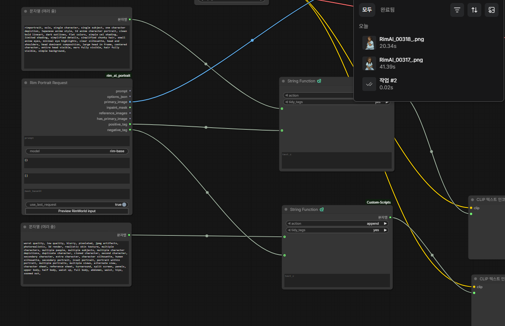

- Style 태그 참고
  
  - Positive: rimportrait, solo, single character, single subject, one character depiction, Japanese anime style, 2d anime character portrait, clean bold lineart, dark outlines, flat colors, simple cel shading, limited shading, simplified details, simplified chunky hair, small anime eyes, minimal eye highlights, clear silhouette, head and shoulders, head dominant composition, large head in frame, centered character, entire head visible, ears fully visible, hair fully visible, simple background,
  
  - Negative: worst quality, low quality, blurry, pixelated, jpeg artifacts, photorealistic, 3d render, realistic skin texture, multiple characters, multiple people, multiple subjects, multiple character depictions, duplicate character, cloned character, second character, secondary character, extra character, character silhouette, human silhouette, secondary portrait, inset portrait, portrait within portrait, multiple portraits, multiple views, alternate view, character sheet, reference sheet, turnaround, split screen, panels, upper body, half body, waist up, full body, abdomen, waist, hips, zoomed out,

#### 4-2-3. 최종 결과

- KSampler에 잠재 이미지와 태그, 모델을 받습니다.

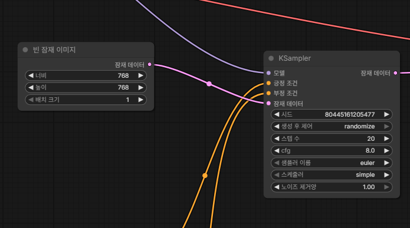

- 배경은 자동 제거하고(BiRefNet) Rim Portrait Response로 이미지를 내보냅니다.

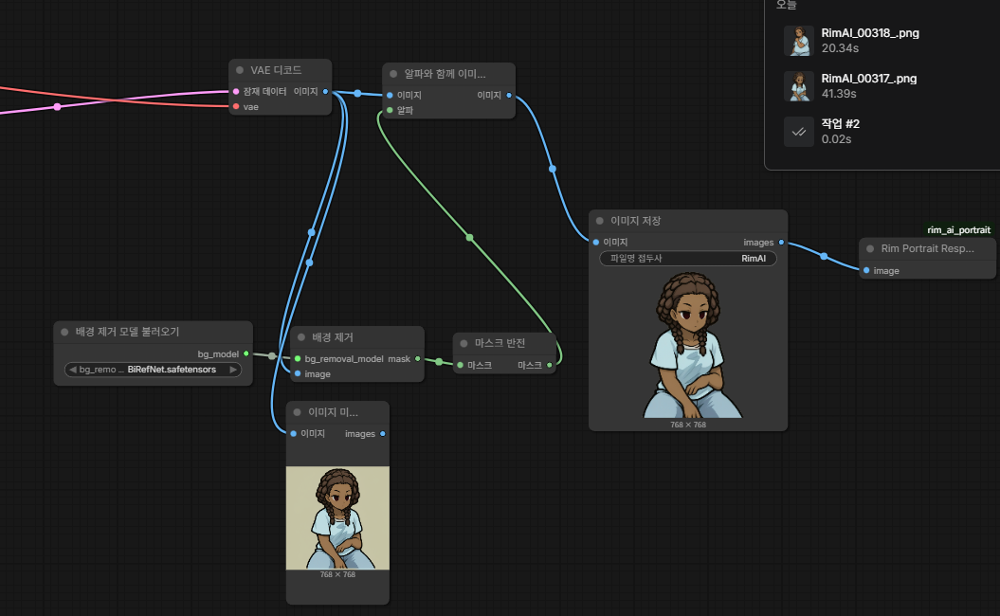

## 5. Custom Workflow 예시: Expressive

### 5-1. 소개

- 같은 폴더의 rim-expression.json은 예시 workflow 입니다.

- 태그를 쉽게 다루기 위해서 [String Function](https://github.com/pythongosssss/ComfyUI-Custom-Scripts) Custom Node를 설치해서 사용하였습니다.

- 반드시 모델 이름과 림월드의 모델, workflow 이름을 똑같이 설정해야만 정상 동작합니다.

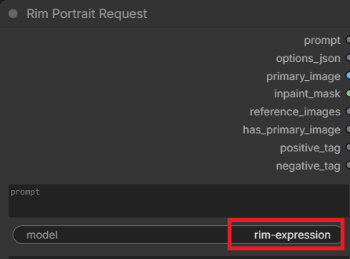

### 5-2. Workflow

#### 5-2-1. 모델 로딩

- base workflow와 같습니다.

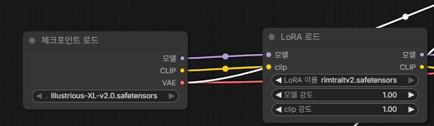

#### 5-2-2. 태그 생성

- base workflow의 태그 생성과 같습니다. 인게임의 Tag Extractor를 쓰고 있습니다.

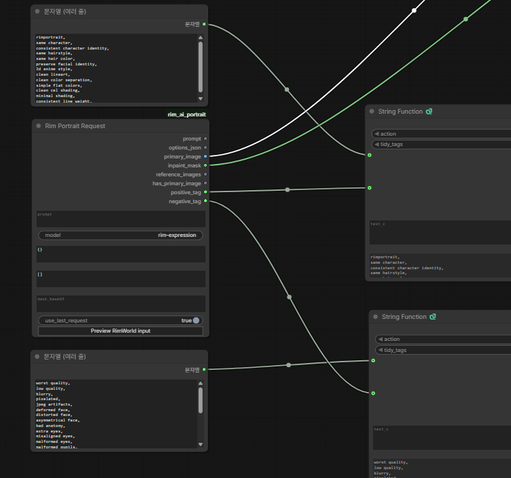

#### 5-2-3. 입력 이미지와 마스크 처리

- VAE 인코드에 표정을 수정할 입력 이미지를, 잠재 데이터에 노이즈 마스크 설정에 마스크를 공급합니다. 

- 잠재 데이터 출력은 KSample로 갑니다.

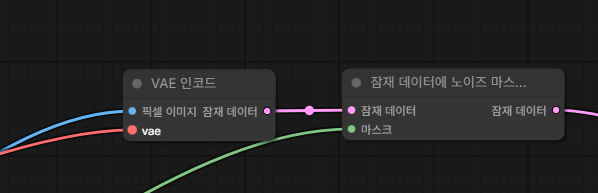

#### 5-2-4. 최종 출력

- Request 노드의 weight를 KSampler의 Weight와 연결합니다.

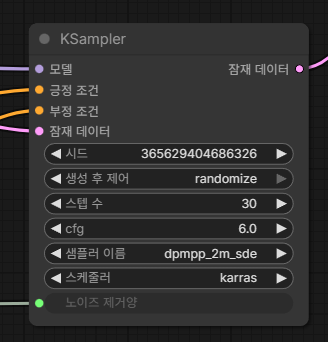

- 배경 제거와 출력은 base와 같습니다.

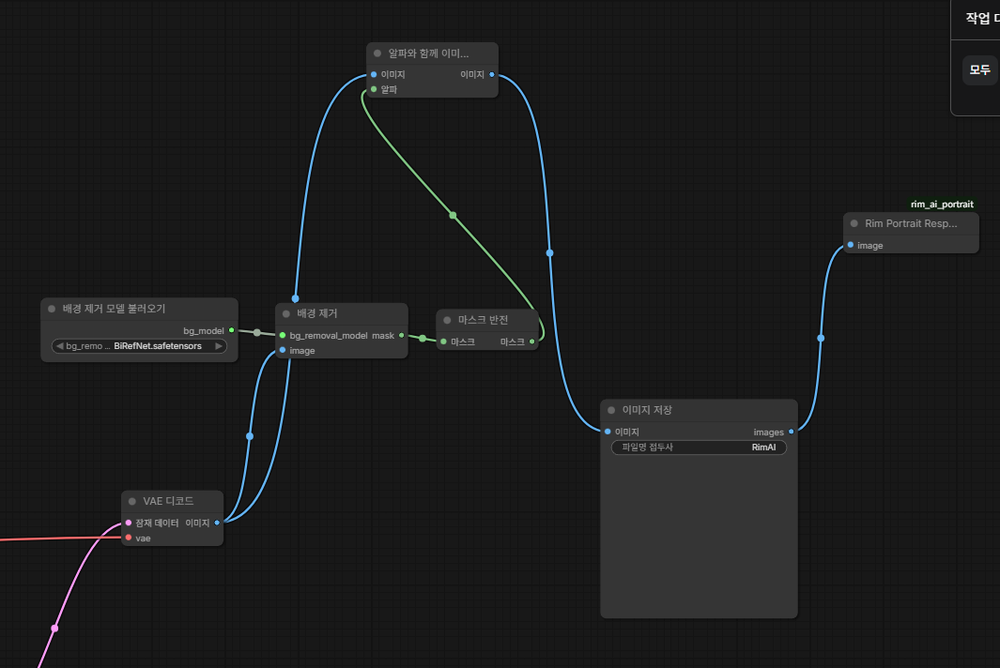

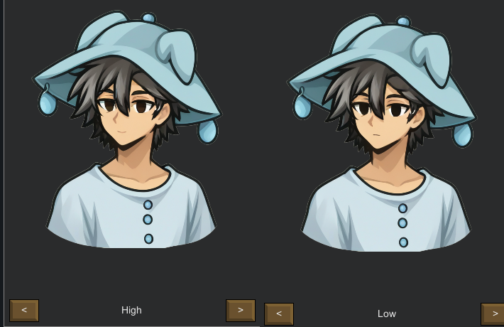
