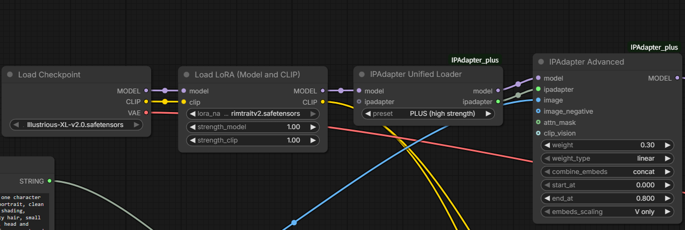
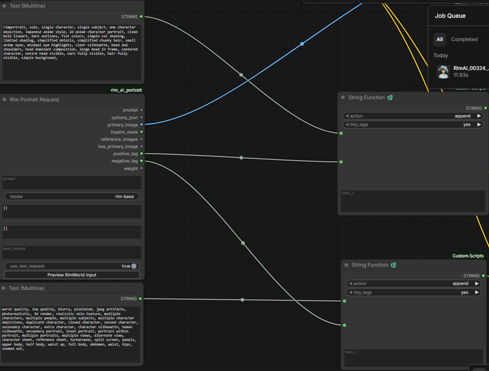
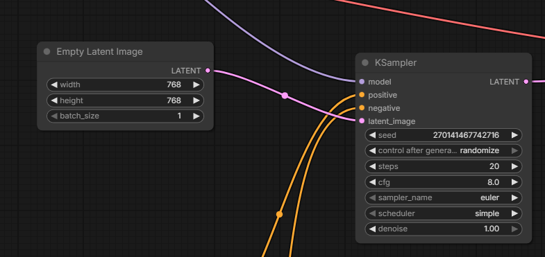
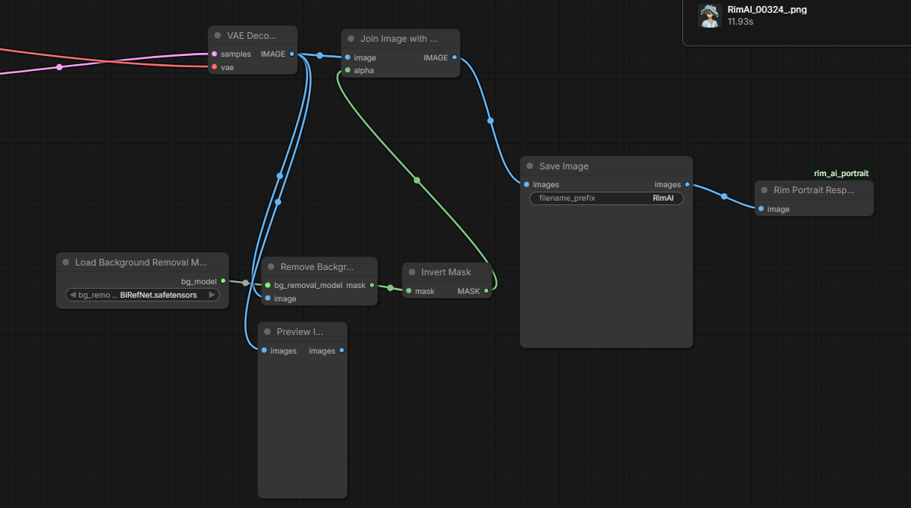
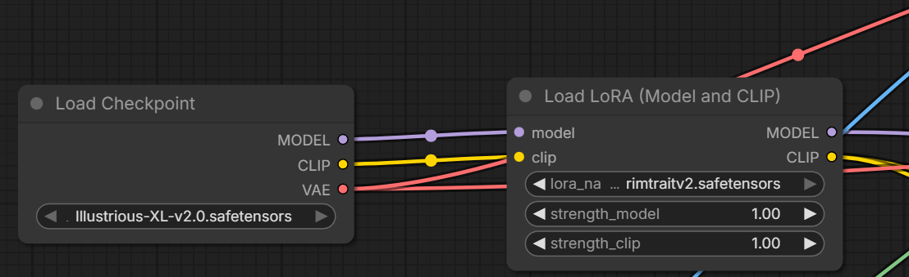
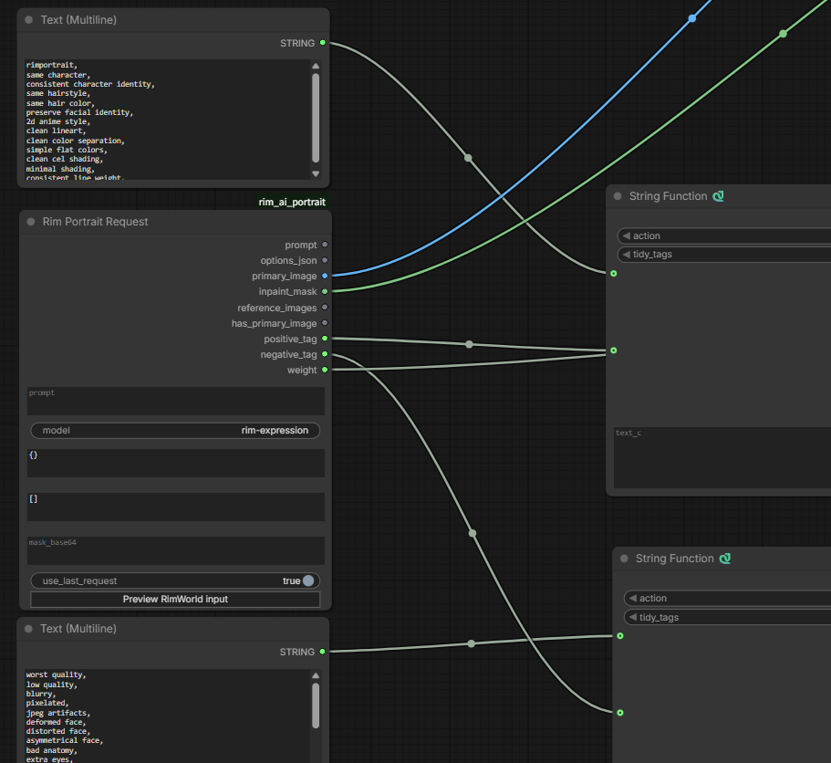
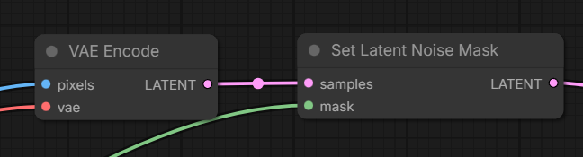
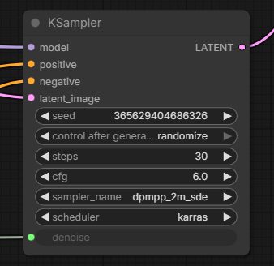
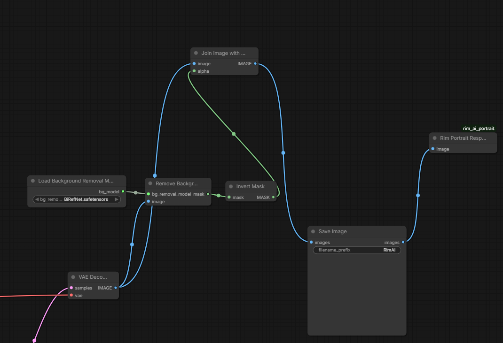

# ComfyUI Custom Node for Rim AI Portrait

## 1. Introduction

- This ComfyUI custom node works with the Rim AI Portrait mod.
- This tutorial assumes you already know how to install a ComfyUI custom node.

## 2. Setup

1. Copy `rim_ai_portrait/` from this folder to `ComfyUI/custom_nodes/rim_ai_portrait/`, then restart ComfyUI.

2. In the RimWorld mod, select the **Local (OpenAI compatible)** provider and set its URL to `http://127.0.0.1:8188/v1`. Change the port if yours is different. The model name must match the filename of an API-format JSON file under `workflows/`, without the `.json` extension.

3. Connect the nodes to build your own setup. To generate portraits, connect the prompt, source image, and mask outputs of **Rim Portrait Request** to your generation graph, then connect its final `IMAGE` output to **Rim Portrait Response**.

4. Click the **Preview** button on the Request node to inspect the most recent request. This can help while building your workflow.

## 3. Custom nodes

- **Rim Portrait Request** is the input node. It provides the prompt, images, and other request data.
  - `prompt`: The prompt, which also contains other information about the request.
  - `options_json`: Values configured in the mod's options. You usually do not need this output.
  - `inpaint_mask`: The mask for the area selected when editing an image or expression.
  - `reference_images`: Reference images.
  - `has_primary_image`: Whether the request includes a primary input image.
  - `positive_tag` / `negative_tag`: Tags produced by the Tag Extractor. If your local model struggles with natural-language prompts, you may find it useful to add a language model to the workflow.
  - `weight`: The value selected in the Local inpaint dialog. Connect it to the appropriate numeric input in your workflow.

- **Rim Portrait Response** is the output node. A working workflow must have one.
- **Rim Portrait Reference** selects a reference image.

## 4. Example custom workflow: Base

### 4-1. Introduction

- `rim-base.json` in this folder is an example workflow.
- This example uses the [String Function](https://github.com/pythongosssss/ComfyUI-Custom-Scripts) custom node to work with tags.
- It uses [IP Adapter](https://github.com/cubiq/ComfyUI_IPAdapter_plus) to capture features from the character sprite.

### 4-2. Workflow

#### 4-2-1. Loading models

- Tags are extracted automatically by the in-game Tag Extractor. I use `gemini-2.5-flash-lite` to keep costs down. I tried building the workflow without a Tag Extractor, but found it extremely difficult to get satisfying results.
- For this example, I use `illustrious-XL-v2.0` and a LoRA trained for the look I want. I am not sharing the LoRA because of possible copyright concerns.
- IP Adapter extracts visual features from the input image.

#### 4-2-2. Building tags

- I put some tags directly into a ComfyUI string node and use String Function's append feature to combine them with the tags extracted in-game.
- I discard the prompt because the Tag Extractor supplies the tags I need.

Style tag examples:

- Positive: rimportrait, solo, single character, single subject, one character depiction, Japanese anime style, 2d anime character portrait, clean bold lineart, dark outlines, flat colors, simple cel shading, limited shading, simplified details, simplified chunky hair, small anime eyes, minimal eye highlights, clear silhouette, head and shoulders, head dominant composition, large head in frame, centered character, entire head visible, ears fully visible, hair fully visible, simple background,
- Negative: worst quality, low quality, blurry, pixelated, jpeg artifacts, photorealistic, 3d render, realistic skin texture, multiple characters, multiple people, multiple subjects, multiple character depictions, duplicate character, cloned character, second character, secondary character, extra character, character silhouette, human silhouette, secondary portrait, inset portrait, portrait within portrait, multiple portraits, multiple views, alternate view, character sheet, reference sheet, turnaround, split screen, panels, upper body, half body, waist up, full body, abdomen, waist, hips, zoomed out,

#### 4-2-3. Final result

- KSampler receives the latent image, tags, and model.

- BiRefNet removes the background automatically, and Rim Portrait Response sends the image back to the mod.

## 5. Example custom workflow: Expressive

### 5-1. Introduction

- `rim-expression.json` in this folder is an example workflow.
- This example also uses the [String Function](https://github.com/pythongosssss/ComfyUI-Custom-Scripts) custom node to work with tags.
- The model name in RimWorld must match the workflow name and its model field for the request to run correctly.

### 5-2. Workflow

#### 5-2-1. Loading models

- This is the same as in the Base workflow.

#### 5-2-2. Building tags

- This is the same as in the Base workflow. I use the in-game Tag Extractor.

#### 5-2-3. Processing the input image and mask

- Send the source image for the expression edit to VAE Encode, and the mask to Set Latent Noise Mask.
- Send the resulting latent data to KSampler.

#### 5-2-4. Final output

- Connect the Request node's `weight` output to KSampler's Weight input.

- Background removal and output work the same way as in the Base workflow.

