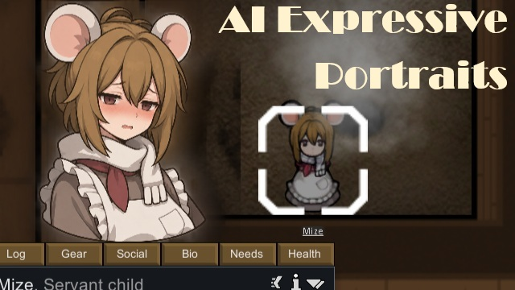

## 1. RIM AI Expressive Portraits

---

- **RIM AI Expressive Portraits**는 정착민의 **게임 내 모습(스프라이트), 건강 상태, 나이, 성별 등의 정보**를 바탕으로 AI 초상화를 생성해주는 모드입니다.

- 정착민의 **게임 내 모습, 건강 상태, 나이, 성별 등의 정보**를 조합해 Gemini, OpenAI 또는 ComfyUI로 초상화를 생성합니다.

- 또한 정착민의 상태에 따라 **다른 모습을 표시 가능합니다.**

## 2. 요구 사항

---

- RimWorld 1.5 or 1.6

- [Harmony](https://steamcommunity.com/sharedfiles/filedetails/?id=2009463077)

- 이미지 생성이 가능한 Provider:
  
  - OpenAI API key
  - Google AI API key
  - NAI
  - local Model(Open AI API 표준 기반)

## 3. 기능

---

### 3-1. 기본 초상화 생성

- 정착민의 행동 목록에 AI 초상화 메뉴를 여는 버튼이 있습니다.

- Base 프롬프트는 모든 정착민이 공유합니다. 정착민 개별 특징은 Extra에 입력하세요. 

- 생성 방법은 다음과 같습니다.
  
  - Generate new Base 버튼을 누릅니다.
  
  - 기다리면 자동 적용됩니다.
  
  - 갤러리에서 더블클릭이나 Confirm을 통해서 바꿀 수 있습니다.

- 그 외 지원 기능은 다음과 같습니다.
  
  - 선택한 이미지 재생성
  - 배경색 삭제
  - 이미지 삭제
  - 이미지 폴더 열기
  - 컨트롤 클릭, 쉬프트 클릭을 통한 여러 이미지 선택.

### 3-2. 감정 초상화 생성

생성된 감정으로 부터 여러 파생된 감정 상태 초상화를 생성 가능합니다.

- 여러 감정 표현이 있지만, 옵션에서 체크해야 보입니다. 기본으로 Low(무드 낮음)과 High(무드 높음)만 켜져있습니다.

- 생성 방법은 다음과 같습니다.
  
  - Base 이미지를 선택합니다.
  
  - Generation emotions from Base를 누릅니다.
  
  - 생성할 감정만 체크하고 생성합니다.
  
  - 생성이 완료된 감정은 자동 적용됩니다. 화살표키로 현재 선택 감정을 넘기면서 더블클릭 혹은 Confirm으로 현재 보는 감정을 적용 가능합니다.

### 3-3. 배경 제거

- 좌클릭을 통해서 배경을 날릴 수 있습니다.
  
  - Backgroudn sensitivity: 높을수록 더 공격적으로 색상을 날립니다.
  
  - Edge erosion: 배경색과 접한 부분을 추가로 날립니다. 
  
  - Undo: 마우스 클릭을 한 번 되돌립니다.
  
  - Auto remove enclosed areas: 캐릭터 내부에 둘러쌓인 영역도 자동 제거 합니다.

### 3-4. OpenAI

- 테스트 된 모델 중에 sunburst의 low quality를 이용할 시 가격 대비 품질이 가장 우수합니다. medium/high는 가격이 꽤 비쌉니다.
- 투명 배경을 지원하지만, 일관성 문제로 꺼져있습니다.

### 3-5. Google Gemini

- 투명 배경을 지원하지 않습니다. 

- gemini-3.1-flash-lite-image기준 sunburst low 대비 약 2배 정도의 단가를 지닙니다.

### 3-6. Local Model

- 로컬 모델 셋업은 정말 많은 시간과 노력을 투자해야합니다. 제작자도 이걸로 아직 원하는 퀄리티를 뽑아내지 못했습니다.

- OpenAI 규격을 따르고 있으며, 이를 처리 가능한 [Comfy Custom Node](./Comfy/README-KR.md)가 제공됩니다. 

### 3-7. NovelAI(NAI)

- NAI는 구독제입니다. v4.5가 안정적이며, v5는 기능이 매우 제한적입니다.

- NAI 경우 OpenAI/Google과 달리 "그림 생성 모델"로서 특징이 더 강해서 유연성이 떨어집니다.

- 이 유연성을 지원하기 위해서 Inpaint와 Tag Extractor 기능을 제공합니다.

- Inpaint: 바꿀 영역을 드래그로 선택합니다. Inpaint Strength에 따라 더 강하게 바꿉니다. Sleep 등 눈을 완전 바꾸는 표현은 Strength를 높게 주어야합니다. Positive·Negative 태그를 직접 수정해 결과를 조정할 수 있습니다.

- TagExtractor: LLM을 통해서 입력된 그림을 인식하고 positive/negative 태그로 변환합니다.

- NAI 기준 Mod Race는 잘 인식하지만, 바닐라의 경우 너무 단순해서 거의 인식하지 못하는데, Tag Extractor를 키는 경우 이를 어느정도 극복 가능합니다.

---

### 4-1. 기본 옵션

- Provider는 OpenAI/Gemini/Comfy(Local Model)/NAI 중에 고를 수 있습니다.

- 기본으로 OpenAI와 gpt-image-2.5-sunburst 으로 설정되어있으며, API Key를 넣으면 됩니다.

- 어떤 정보가 프롬프트에 자동으로 반영될지 고를 수 있습니다. 기본적으로 캐릭터의 인게임 이미지와 텍스트 정보(성별, 나이) 등을 동시에 반영해서 이미지를 생성합니다.

### 4-2. 감정 옵션

- 정착민의 상태에 따라 초상화를 교체하게 할 수 있습니다. 총 9가지가 있는데, 다켜면 꽤 돈이 많이 나갈거에요. 이 기능은 끄고 사용해도 무방합니다.

- 기본 초상화 생성/감정 표현 생성/초상화 재생성은 서로 다른 모델을 섞어 쓸 수 있습니다.

### 4-3. Style Reference

- 폴더를 지정하면 해당 폴더에 있는 그림의 "그림체"를 참조하는 기능입니다.
  
  - 1~2장이면 충분합니다. 많아도 4장 이상 넣지 마세요. NAI는 한장만 적용 가능합니다. 디폴트는 1~2장이 들어갑니다.
  
  - 파일 해상도를 작게 하세요. 디폴트 스타일은 256x256을 쓰고 있습니다.

### 4-4. 그 외 옵션

- 초상화 크기와 위치를 조절 가능합니다.

## 4. 설치 방법

---

- 창작마당에서 구독하면 됩니다.

## 5. 다른 Provider 지원에 대해서

---

- **다른 Provider에 대한 공식 지원은 정말 많은 시간과 노력과 금전을 필요로 합니다.** Provider를 하나 추가할 때마다 제작자가 해당 서비스에 직접 가입하고, 사용 방법과 API를 익힌 뒤 테스트를 위한 비용까지 충전해야 하기 때문에 지속적으로 지원하기가 어렵습니다. 예를 들어서 제작자는 NAI 지원을 위해 10\$ 요금제를 쓰다가 개발 도중 전부 소진해서 25\$ 요금제를 구매하였습니다.

- 대신 **소스 코드를 MIT 라이선스로 공개**하고 있습니다. 출처와 라이선스 고지만 유지해 주신다면 소스 코드를 자유롭게 수정·빌드하여 **Steam 창작마당에 배포하셔도 됩니다.** 

---

## 6. 비용 참조

- Google, gemini-3.1-flash-lite-image: 1780원/34=52.35원/장

- Openai, gpt-image-2.5-sunburst, low quality: 460원/20장=23원/장

- NAI, nai-diffusion-4-5-full: Opus 월 25달러(한화 34,000) 기준 일정 이하 옵션시 무제한 추정, 그 이하 요금제면 위 둘에 비해 크게 불리한 것으로 추정.

- Comfy: Local Model.

- gpt-image-2.5-sunburst, low quality 위주로 지원이 들어간 이유는 위를 보면 알 수 있습니다. NAI가 가격으로 이기려면 1,360장의 정착민 초상화를 한달에 뽑아야합니다.
