## 1. RIM AI Expressive Portraits

---

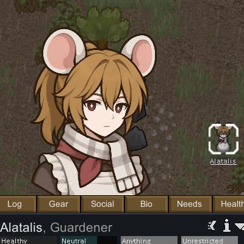

- **RIM AI Expressive Portraits** is a mod that generates AI portraits based on information about your colonists, including their **in-game appearance (sprite), health conditions, age, and gender**.

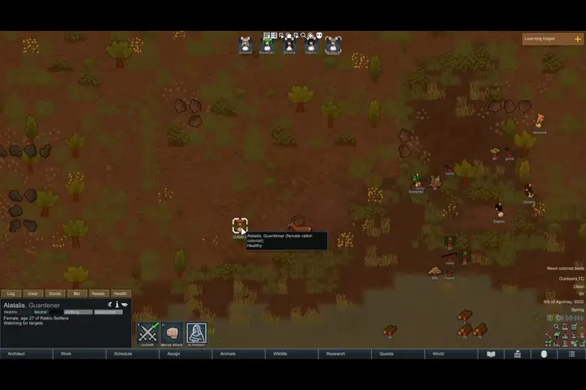

- It combines information such as a colonist's **in-game appearance, health conditions, age, and gender** to generate portraits through Gemini, OpenAI, or ComfyUI.

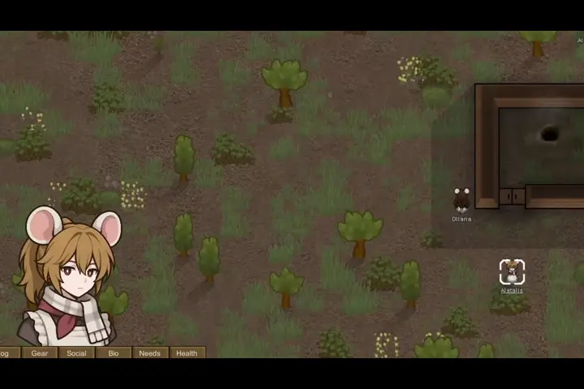

- It can also **display different portraits depending on the colonist's current state.**

## 2. Requirements

---

- RimWorld 1.5 or 1.6

- [Harmony](https://steamcommunity.com/sharedfiles/filedetails/?id=2009463077)

- An image-generation provider:

  - OpenAI API key
  - Google AI API key
  - Local ComfyUI server

## 3. Features

---

### 3-1. Generating a Base Portrait

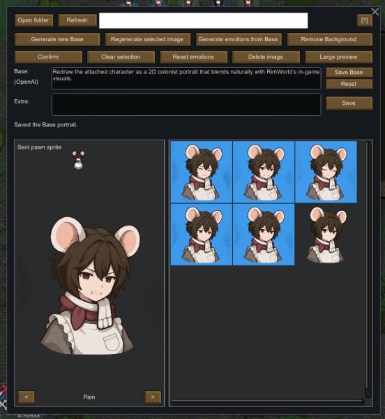

- A button that opens the AI portrait menu is available in the colonist's action list.

- The first time you open a colonist, the Base prompt for the selected Base provider is loaded from the mod settings. You can edit a separate Base prompt for each colonist and provider, or enter additional information in the Extra field. Each colonist has their own settings, which are saved when their first portrait is generated. Existing `base_prompt.txt` files are copied to the selected provider's prompt file when first accessed.

- To generate a portrait:

  - Click **Generate new Base**.

  - Wait for generation to finish; the portrait is applied automatically.

  - To change portraits later, double-click one in the gallery or select it and click **Confirm**.

- Other supported features include:

  - Regenerating the selected image
  - Removing the background color
  - Deleting an image
  - Opening the image folder

  - Selecting multiple images with Ctrl-click or Shift-click

### 3-2. Generating Expression Portraits

You can generate multiple portraits for different emotional states from a generated portrait.

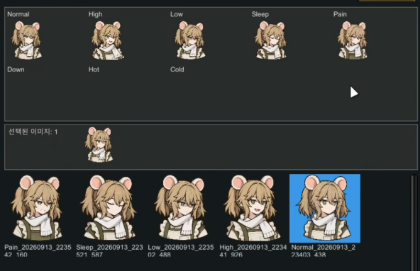

- Several expressions are available, but they must be enabled in the settings before they are shown. By default, only Low (low mood) and High (high mood) are enabled.

- To generate expression portraits:

  - Select a Base image.

  - Click **Generation emotions from Base**.

  - Select only the expressions you want, then generate them.

  - Generated expressions are applied automatically. Use the arrow keys to browse expressions, then double-click or click **Confirm** to apply the one shown.

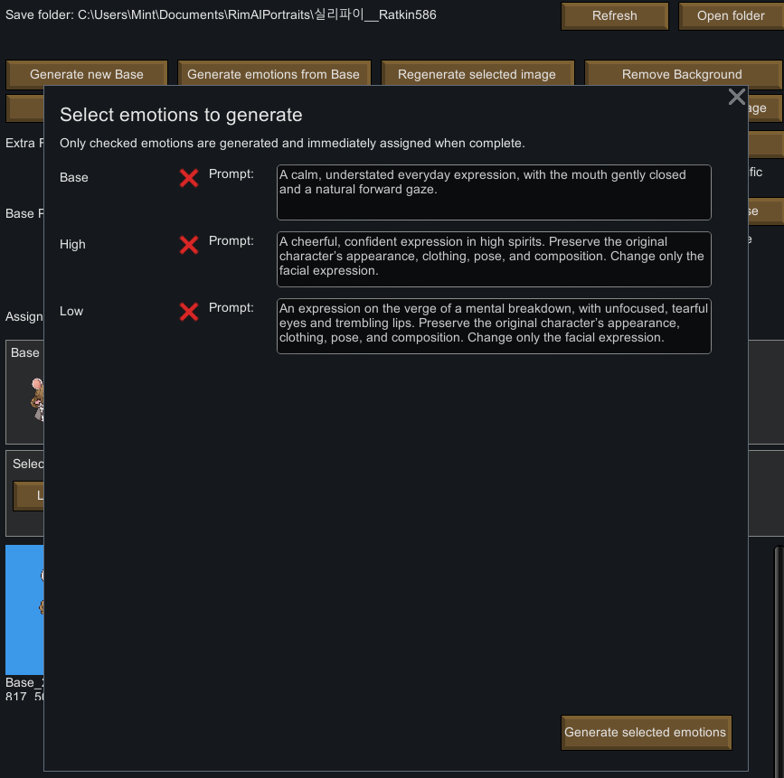

### 3-3. Removing the Background

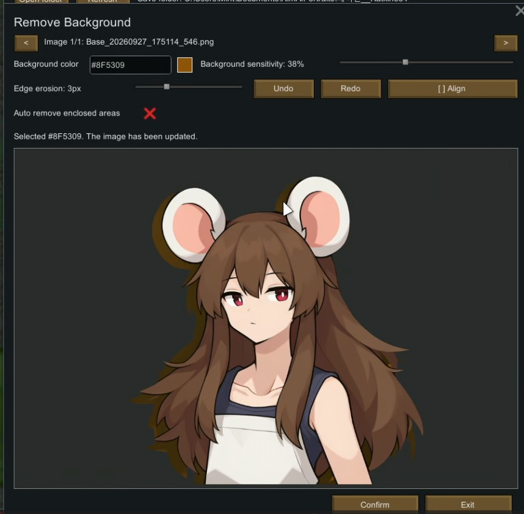

- OpenAI can be instructed to generate an image with a transparent background, but some providers do not support this.

  - Left-click the preview to remove similar colors automatically.

  - **Background sensitivity:** Higher values remove colors more aggressively.

  - **Edge erosion:** Removes additional pixels along the edge touching the background.

  - **Undo:** Reverts the last mouse click.

  - **Auto remove enclosed areas:** Also removes similarly colored areas enclosed within the character.

  - After removing the background, click **Align** to reposition the image against the bottom edge.

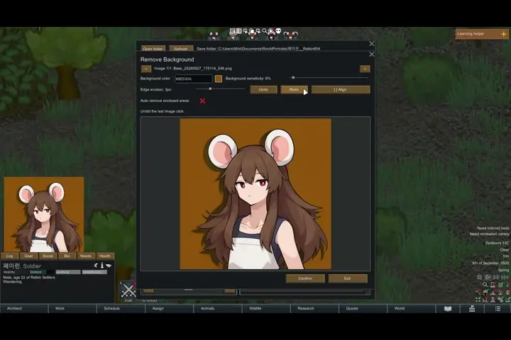

### 3-4. OpenAI

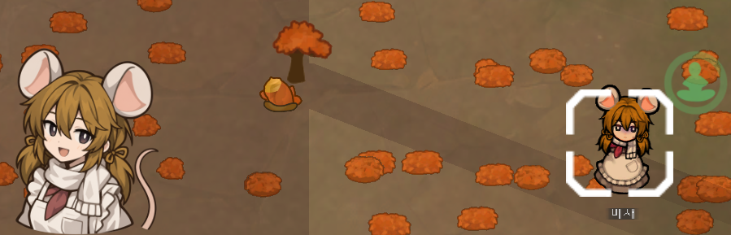

- OpenAI's Sunburst model at low quality is the configuration that has been tested the most. It supports transparent backgrounds and, among the models tested, offers relatively good quality for its price. Medium and high quality are considerably more expensive.

### 3-5. Google Gemini

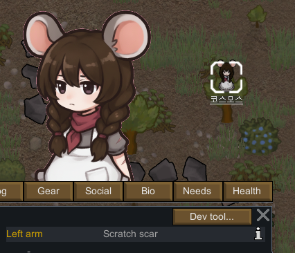

- It does not support transparent backgrounds. Because producing a transparent background through the prompt alone is very difficult, OpenAI became the default during testing.

- It costs about twice as much per image as OpenAI, but follows the reference consistently.

### 3-6. Comfy (Local Model)

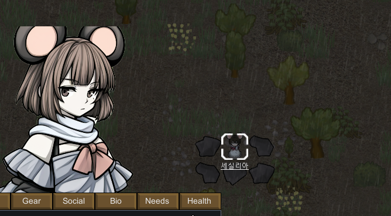

- Setting up a local model requires a great deal of time and effort. The author has not yet achieved the desired quality with it.

- The pipeline used for testing will be published in the future.

### 3-7. NovelAI (NAI)

- NovelAI is subscription based. The prompts have been tuned for V4.5.

- Compared with OpenAI and Google, NovelAI behaves more like a dedicated image generation model and is less flexible. The mod provides Inpaint and Tag Extractor to help with this.

- **Inpaint:** Drag to select the area to change. A higher **Inpaint Strength** changes it more substantially; expressions such as Sleep, which need the eyes to close fully, require a higher strength. Higher strength can also reduce character consistency, so you can enter an **Extra Tag**.

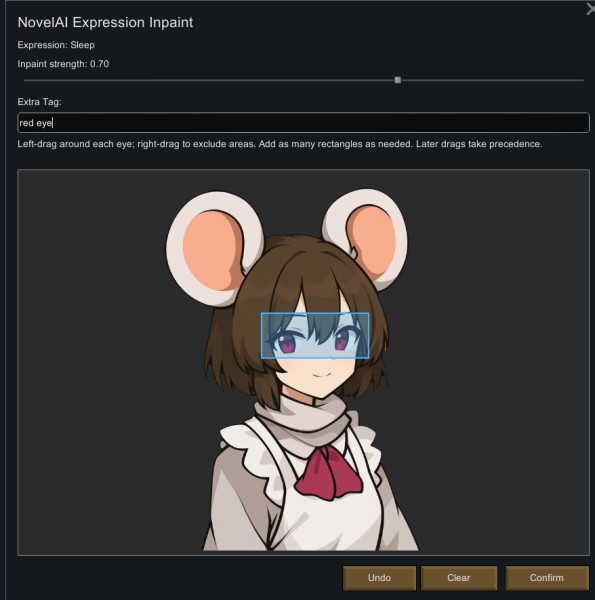

- **Tag Extractor:** Uses Google, OpenAI, or a local LLM to recognize an input image and convert it into positive and negative tags. It is disabled by default. NovelAI tends to recognize characters with distinctive features, such as ratkin, more readily than simple vanilla characters. Tag Extractor converts the natural-language prompt and image into tags that are added automatically to Base and expression requests. It has been verified with Google Gemini Flash Lite 3.5.

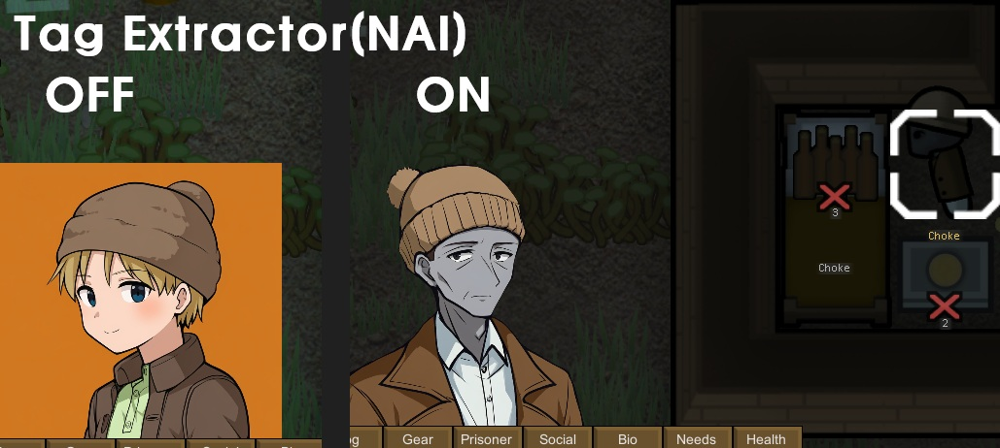

- Sign in to [NovelAI](https://novelai.net/), then open **Settings → Account → Get Persistent API Token** and copy the generated token. Generating a new token invalidates the previous Persistent API Token, so update any other applications that use it as well.

- In RimWorld, open **Options → Mod Settings → RIM AI Expressive Portraits**, change the Base portrait provider to **NovelAI**, and paste the token into **NovelAI API Token**.

- You can use the default `nai-diffusion-4-5-full` model and options as-is. The `Options` JSON can be used to adjust the resolution, steps, scale, sampler, negative prompt, and Character/Style Reference strength and fidelity.

- To generate expression portraits with NovelAI, select **NovelAI** separately under the expression settings and enter the token there. Base and expression provider settings are independent.

- Select a colonist, open the AI portrait menu, and click **Generate new Base**. NovelAI V4.5 Base sends the pawn sprite as a Character Reference and the first image by filename in the **Base style reference folder** as a Style Reference. Enter `Using Default Style` to use the bundled `Style/` folder; an existing folder with no images also falls back to it. Leave the field blank to use no style reference. Selected gallery references cannot be combined with this V4.5 Base path. Expression portraits edit the Base image.

- Generation may require a NovelAI subscription and Anlas. Check your account balance and pricing before use, and never share your API token. NovelAI output may not have a transparent background; use this mod's background-removal feature when needed.

## 4. Options

---

### 4-1. Basic Options

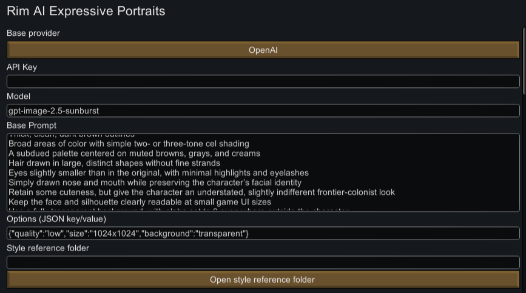

- You can choose between OpenAI, Gemini, Comfy (Local Model), and NovelAI as the provider.

- The default configuration uses OpenAI with `gpt-image-2.5-sunburst`; you only need to enter an API key.

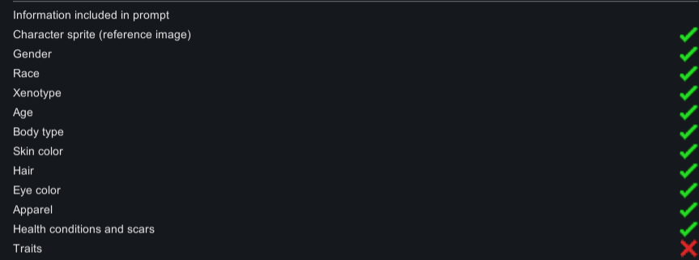

- You can choose which information is automatically included in the prompt. By default, images are generated using both the character's in-game appearance and text information such as gender and age.

### 4-2. Expression Options

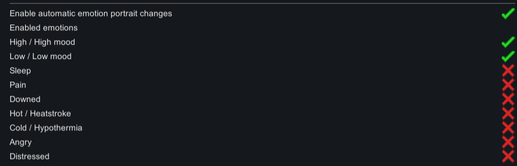

- Portraits can change according to a colonist's state. There are nine states in total, but enabling all of them may become quite expensive. You can use the mod with this feature disabled.

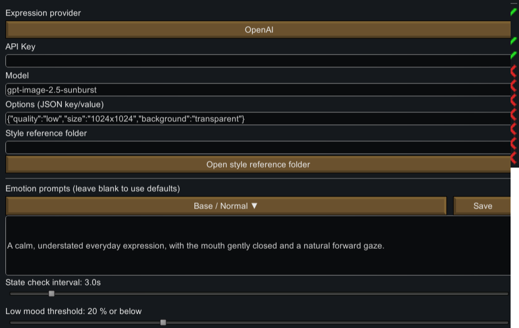

- You can also select a separate provider for expression generation. Both portrait types may use the same provider, or you can mix different providers.

### 4-3. Style Reference

- Specify a folder of images whose visual style should be used as a reference.

  - One or two images are enough; avoid adding more than four. NovelAI can use only one. The bundled default contains one or two images.

  - Use small image files. The bundled style images are 256 × 256 pixels.

  - The default style setting is currently in use.

### 4-4. Other Options

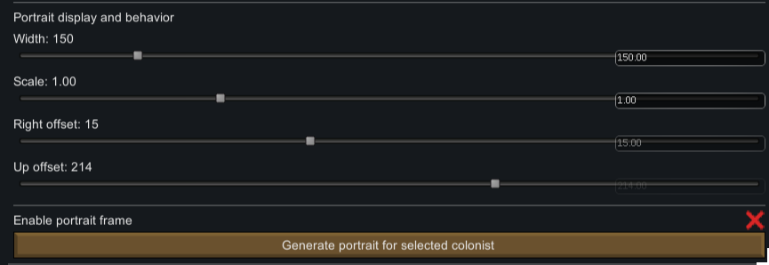

- You can adjust the portrait's size and position.

## 4. Installation

---

- Coming soon.

## 5. Comfy Setup Tips

---

- **Setting up a local model requires a considerable amount of time and effort.** Maintaining consistency between portraits for different expressions makes it even more difficult, so using a local model is not recommended unless you are familiar with this field.

- For reference, the pipeline used by the author while testing the source code will be published in the future.

- Coming soon.

The ComfyUI expression mask is optional. To use it, add a separate `LoadImage` node with filename `__RIM_INPAINT_MASK__` and select an area in the dialog. The selected area is transparent in the uploaded PNG, so the node's `MASK` output is 1 there. Without this token, no mask is uploaded and the dialog can proceed without a selection. Put `__RIM_INPAINT_TAG__` in a text node if the workflow uses the additional tag.

OpenAI and Google generate expressions from the base portrait and other configured references without an inpaint mask or selection dialog. Their returned images are saved without local compositing.

## 6. Support for Other Providers

---

- **Official support for other providers takes substantial time, effort, and money.** Adding a provider requires the author to sign up for the service, learn how to use its API, and pay for testing credits, which makes ongoing support difficult. For example, while adding NovelAI support, the author exhausted a $10 plan and bought a $25 plan to continue development.

- Instead, the **source code is available under the MIT License**. As long as you retain the attribution and license notice, you may freely modify and build the source code and **distribute it on the Steam Workshop.**

- The project structure was also designed with extensibility in mind so that other providers can be added—at least, according to the author's standards.

---

## 7. Building from Source

- Coming soon.

## 8. Cost Reference

The approximate dollar amounts below use the exchange rate implied by the Korean README's estimate of $25 for the Opus plan. Actual charges and exchange rates may differ.

- Google, `gemini-3.1-flash-lite-image`: about $1.31 for 34 images, or $0.039 per image.

- OpenAI, `gpt-image-2.5-sunburst` at low quality: about $0.34 for 20 images, or $0.017 per image.

- NovelAI, `nai-diffusion-4-5-full`: The $25/month Opus plan is estimated to allow unlimited generations below certain option limits. Lower tier plans are estimated to be much less cost effective than the two providers above.

- Comfy: Local model.

- The costs above are why development has focused on `gpt-image-2.5-sunburst` at low quality. By the author's estimate, NovelAI would need to generate 1,360 colonist portraits in a month to beat it on price.

## 9. Future Plans

- v1.2.0

  - Test whether the local LLM and OpenAI options work correctly.

- v1.3.0

  - Add Race Provider support. For example, replace a race name such as "Impid" in the prompt with a description such as "Impid: a horned, demon-like race."

  - Separate the models and processing logic for **Regenerate** from Base and expression generation to improve NovelAI and Comfy performance later.

  - Improve Tag Extractor for expression generation. For example, when the prompt includes "closed eyes," suppress conflicting features such as eye color.

- v1.4.0

  - Improve the user guide.

  - Organize mod settings into categories and tabs.

  - Review further Comfy support.
